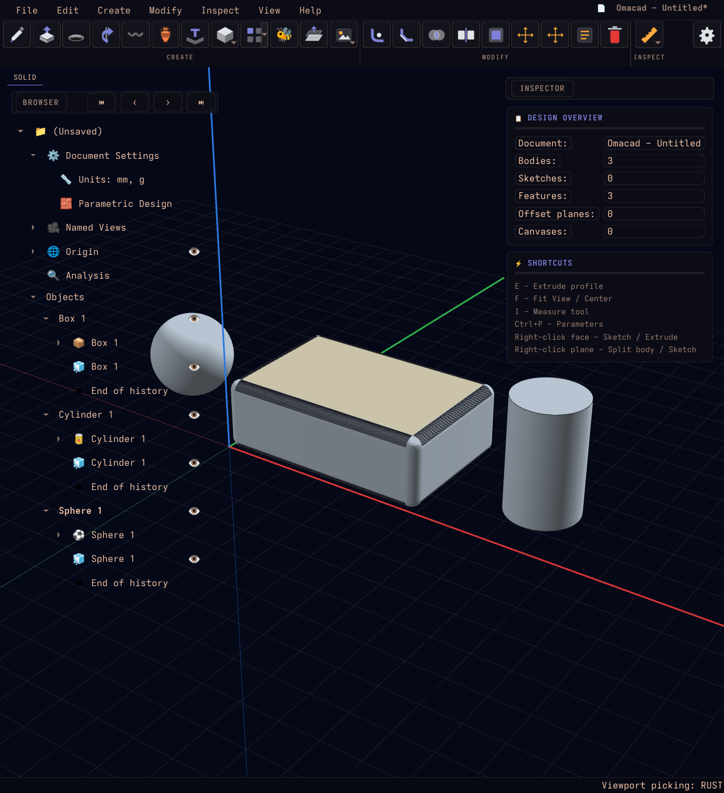

# Omacad Hybrid — Python/Qt + Rust i viewporten

Ett separat testrepo för att behålla **hela Omacads befintliga gränssnitt och
CAD-arbetsflöde** och flytta en tung viewportberäkning till Rust.

Första försöket accelererar **kropps-/ytplockning och ocklusionstester för
kantplockning**. Rust bygger ett BVH-index över trianglarna och svarar på musens
stråltester. PySide6, OpenGL-renderingen, skisser, modellering, filer och ångra/gör
om körs fortsatt med Omacads Python-kod. Det är alltså inte en omskriven CAD-app.

Utgångspunkt: Omacad `fdf4331` / `0.9.9.80.69`. Experimentet har eget Git-repo,
egen miljö och egen profil. Ursprungliga Omacad och omacad-rs påverkas inte.

## Köra

Linux, Python 3.14, Rust/Cargo, C/C++-kompilator och `uv` behövs.

```bash
./tools/setup_hybrid.sh
./run.sh --backend rust
```

På den här maskinen är miljön och Rust-modulen redan byggda. För jämförelse:

```bash
./run.sh --backend python
./run.sh --backend auto
```

Starta också via **Omacad Hybrid** i appmenyn, eller kommandot `omacad-hybrid`.
Menyikonen har ett blått **H** och startar Rust-läget. Installera om menyknappen
på en annan maskin med:

```bash
.venv/bin/python tools/install_launcher.py
```

Statusfältet visar den backend som faktiskt används. `auto` faller tillbaka till
Python om modulen saknas; `rust` kräver en fungerande modul. Bygg om Rust separat:

```bash
./tools/build_native.sh
```

Inställningar, sessioner, teman och cache ligger i `.state/` (ignoreras av Git).
Ingen automatisk omstart eller bakgrundssändning av problemrapporter körs.

## Testa och mäta

```bash
cargo test --manifest-path native/Cargo.toml --lib
OMACAD_VIEWPORT_BACKEND=rust .venv/bin/python -m pytest \
  tests/test_viewport_native.py tests/test_hover_after_move.py \
  tests/test_fillet_face_pick.py tests/test_loop_edge_pick.py -q
OMACAD_VIEWPORT_BACKEND=python .venv/bin/python -m pytest \
  tests/test_hover_after_move.py tests/test_fillet_face_pick.py \
  tests/test_loop_edge_pick.py -q
OMACAD_VIEWPORT_BACKEND=rust .venv/bin/python tools/benchmark_viewport.py \
  --output benchmark-local.json
```

[Verifiering och bilder](docs/VALIDATION.md) samt [uppmätta tider](docs/benchmark-linux.json) skiljer på första indexbygget och
upprepade plockningar. Varje träff jämförs med NumPy innan en hastighetsvinst
rapporteras. Detta mäter **CPU-plockning**, inte FPS eller hela appens hastighet.

[Arkitektur, avgränsning och verifiering](docs/HYBRID.md) beskriver Python/Rust-
gränsen och cachelivslängden. [Ursprunglig Omacad-README](docs/UPSTREAM_README.md)
har resten av appens dokumentation.


