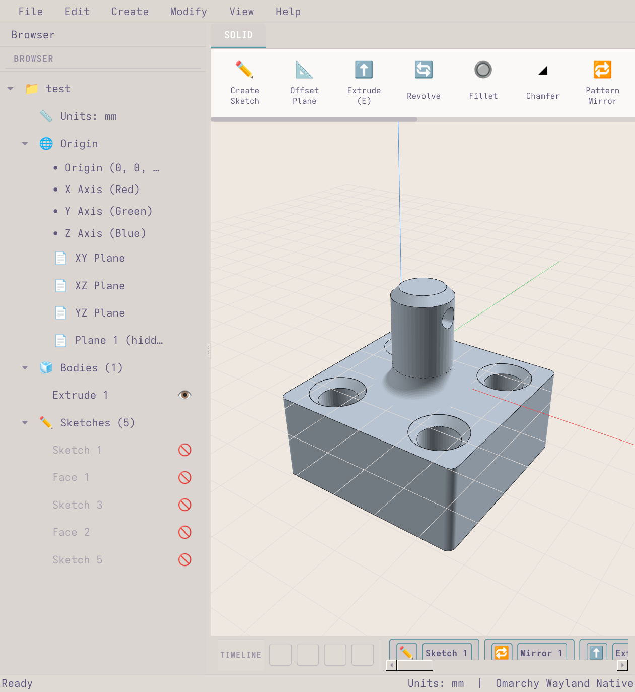
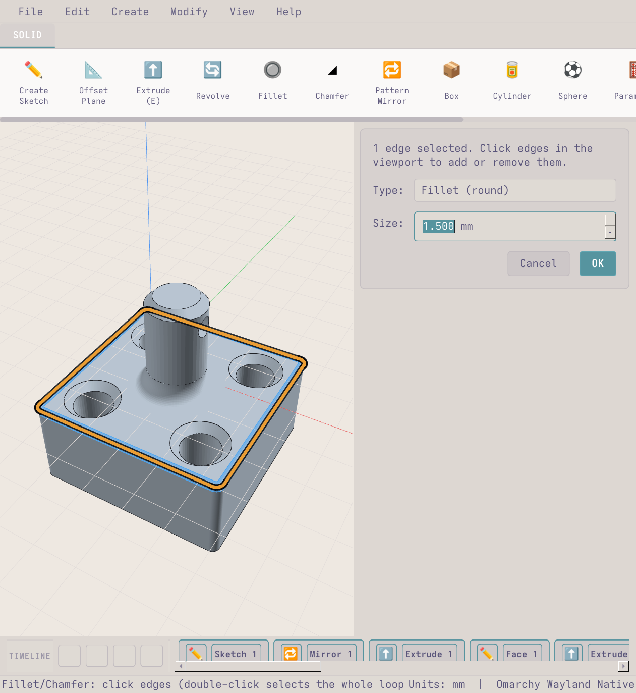
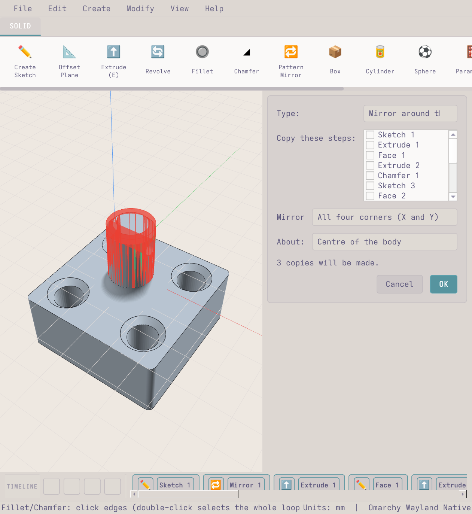
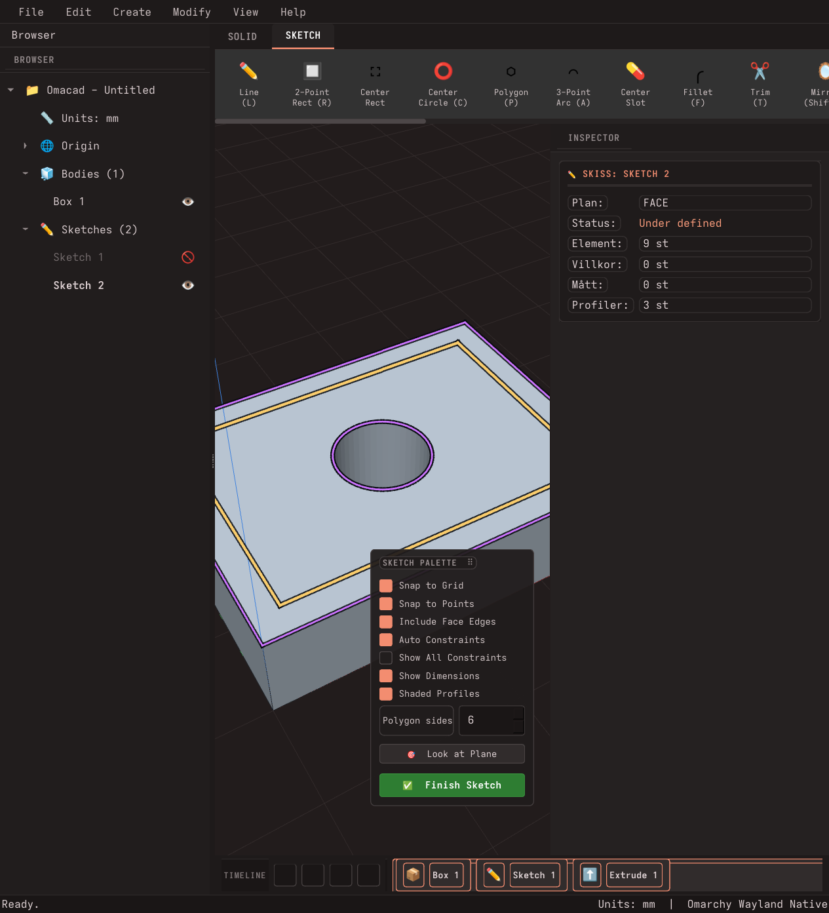

# Omacad ⚡

Offset (`O`) fungerar nu på splines: välj kurvan och ange avstånd med förhandsvisning. Öppna kurvor: positivt åt vänster i ritriktningen; slutna: positivt utåt. Resultatet är en fristående spline som kan ångras (0.9.9.80.69).

Canvas kan nu infogas på en plan kroppsyta: högerklicka på ytan → Insert Canvas on this Face, eller välj ytan i Canvas-dialogens planlista (0.9.9.80.64).

Linjärt Pattern kopierar nu hela ihåliga kroppar, med hål och avrundningar, både i förhandsvisningen och efter OK (0.9.9.80.63).

Loft bevarar nu hål i väggprofiler. Lägg till, ta bort och ordna profiler i listan, även via Edit på ett befintligt Loft (0.9.9.80.62).

Fillet vid foten av en lutande ribba blir hel, hela cirklar på burkens skuldra kan väljas igen, emboss hittar väggen bakom en fillet och testerna körs parallellt på 2,5 min (0.9.9.80.45).

Temavalet är nu Studio, Graphite, Atelier eller Följ Omarchy; de äldre temana är borttagna och ett sparat äldre val öppnas som Studio (0.9.9.80.42).

Tre nya utseenden från designförslaget: **Studio**, **Graphite** (mörkt, bärnsten) och **Atelier** (varmt, skogsgrönt) (0.9.9.80.40). Värden i browsern redigeras med pennan till höger på raden (0.9.9.80.39).

Nytt utseende **Studio** (0.9.9.80.36): ljust, vita paneler och blå accent, med egna linjeikoner för alla funktioner (0.9.9.80.37). Välj det i Settings > Appearance (Theme Mode: Studio, Icon Theme: Studio).

Inställningarna har fått sidomeny, temaanpassade sektionskort och kompaktare färgval (0.9.9.80.35).

Rutnätet skymmer inte kroppen underifrån. Fasade konturer har sammanhängande ytor och kompletta kantlinjer även när samma båge ingår i flera val (0.9.9.80.34).

Fasning av rundade konturer behåller dubbel precision och ger inga falska kantlinjer över fasen eller väggen (0.9.9.80.33).

**Circular Feature Pattern:** öppna Pattern-pilen → Circular Pattern (Features), välj ribban och dess fillet i tidslinjen/listan, välj rotationsaxel och totalantal. Välj X/Y/Z eller klicka en cirkelkant/cylinderyta. Originalet ingår i antalet; 360° ger ett helt varv.

**Rotera skisselement:** markera en figur (dubbelklick) eller flera element (Ctrl+klick), välj **Rotate (Shift+R)** och ange vinkel. Välj pivot i figurens areacentrum, markeringens mitt, kroppsytans centrum, skissens origo eller en egen punkt med klick/exakta koordinater. Förhandsvisning, OK och Esc; hela rotationen är ett ångra-steg. Text som följer en bana behöver först kopplas loss från banan för fri rotation.

Verktygspanelens måttfält har sliders; du kan fortfarande skriva exakta värden och formler.

Box, cylinder och prisma (hexagon) har **Taper angle**: positiv vinkel smalnar av uppåt, negativ vinkel vidgar, 0° ger raka väggar. Fungerar även med shell.

Primitiver: dra kroppen i förhandsvisningen med vänster musknapp för att placera den i X/Y; dra de blå måtthandtagen för att ändra boxens längd/bredd/höjd, cylinderns radie/höjd eller sfärens radie (prisma: mått över planen och höjd). Placeringen och måtten följer med; OK skapar och Esc avbryter. **Prism** (tidigare Hexagon) har samma val som Cylinder (Shell Wall, Outer/Inner Edge, Taper, placering på yta) och väggen, rundningen och lutningen mäts vinkelrätt mot planen. Ihåliga former gör du med **Shell Wall** direkt i Box-, Cylinder- och Prism-panelen (0 = massiv, öppen topp när väggen är större än 0).

**Version 0.9.9.76** (se [CHANGELOG.md](CHANGELOG.md)). 0.x medan funktionerna växer, 1.0 när Omacad är ett komplett och pålitligt CAD.

**Omacad** är ett native parametriskt 3D CAD-program för **Omarchy Linux** (Arch + Hyprland/Wayland), inspirerat av **Autodesk Fusion 360**.
Byggt med **Python 3.14**, **PySide6 (Qt6) + OpenGL**, **manifold3d** (vattentäta booleans), **shapely** och **SolveSpace** (skiss-villkor).
Fönstret följer Omarchys aktiva tema och typsnitt, eller ett eget tema: **Inställningar › Theme editor** låter dig ställa alla färger, se dem live och spara dem under ett namn.
Vill du se sömmarna där en rak vägg går över i en båge eller fillet (som i Fusion) slår du på **Inställningar › Sketch & View › Show tangent edges**.



## Funktioner

**Skissa**
- Skissa på origin-plan, på valfri plan yta (högerklick → *Create Sketch on this Face*) och på egna plan (Offset Plane).
- Linje, rektangel, centrumrektangel, cirkel, 3-punktsbåge, slot och **regelbunden polygon** (`P`: trianglar, hexagoner ... klicka mitten, Tab ger sidlängd och antal sidor). Snäpper mot hörn, kanter, mittpunkter, rutnät och kroppens kanter. 3-punktsbågen **fastnar i tangent läge** (grön ring) när den nästan går slätt över i en linje, båge eller kroppskant som slutar i dess start- eller slutpunkt.
- **Tab-inmatning** medan du ritar (längd, vinkel, bredd/höjd, diameter) – Enter går vidare, Esc ångrar.
- **Verktygspanel** överst i skisspaletten för varje skissverktyg: vad du ska göra härnäst och verktygets mått som fält med reglage. Ett värde du sätter där låses för följande former tills *Follow the mouse*.
- **Mått och villkor** (SolveSpace): horisontell, vertikal, parallell, vinkelrät, lika, tangent, koncentrisk, **mittpunkt**, fixerad, avstånd, längd, vinkel, diameter, punkt–linje. Guidad högerklicksmeny på varje element.
- Markera (klick, **Shift/Ctrl+klick** lägger till och tar bort), flytta (dra eller `M` med X/Y-reglage och *Copy*), **Pattern** (rader och kolumner eller runt ett centrum, med reglage), ta bort, ångra/gör om. Hovra över ett mått för att se vad det mäter. Linjetjocklek och färg på markerade linjer ställs in under Inställningar.
- **Rektangelknappen** har en rullgardin: 2-Point, Center och **Rounded Rect** (två hörn ger rundade hörn direkt, radien i skisspaletten). *Button default* väljer vilken som knappen ritar.
- **Automatisk omstart** när en ny version har committats: arbetet (dokument, öppen skiss, kamera) sparas och återställs. Kan stängas av i Inställningar.
- **Offset (`O`)** som i Fusion (bågar behåller sina centrum och radierna följer med, fogarna räknas om): klicka en kurva så följer hela den sammanhängande kedjan med, klicka fler för att lägga till (Alt+klick = ett element), Enter anger avstånd med förhandsvisning (negativt = inåt).
- **Trim (`T`)**: ta bort biten av en linje, cirkel eller båge fram till närmaste korsning eller fria ände (tar bort lösa stumpar).
- **Mirror (`Shift+M`)** i skissen: välj former, sedan en linje eller origoaxel att spegla över.
- **Ytans kanter som skisslinjer**: skissar du på en yta följer dess yttre linjer, hål och bågar med som riktiga (lila) skisselement. De går att offsetta, trimma, snappa mot och rita vidare från. *Include Face Edges* i skisspaletten stänger av det, och **Project (edges)** tar in kanterna i vilken skiss som helst.
- **Skiss-Fillet (`F`)**: hörn mellan linjer, mellan en linje och en båge eller mellan två bågar. Klicka ett hörn, eller **Shift+klicka** flera hörn, eller **dra en ruta** runt alla hörn du vill ha, och tryck Enter för en radie till alla (förhandsvisning, ett ångra-steg).
- **Rutmarkering** i skissen: dra en ruta på tom yta (vänster→höger = bara det som ligger helt innanför, höger→vänster = allt rutan rör vid). Ctrl+dra lägger till. **Alt+dra** roterar vyn i skissläget.
- **Canvas / Referensbild**: Infoga ritningar och referensbilder på valfritt plan. Bildredigering (ljusstyrka, kontrast, invertering, gråskala, rotation, beskärning) och **kalibrering med virtuellt måttband** (klicka två punkter och ange mm) för att rita av i skala 1:1.

**Solider**
- **Extrude** med dragbar pil i vyn *och* inskrivet värde, riktning (en sida, symmetriskt, två sidor), *To face…*, **Twist** (profilen vrids runt sin mitt, t.ex. en vriden vas), Auto / New Body / Join / Cut / Intersect. Förhandsvisning och profilval i vyn: inget väljs åt dig, klicka på en profil och **Shift+klick** lägger till eller tar bort fler (t.ex. ringen och cirkeln i den). Extrudera också en hel yta.
- **Text i skissen** (som Fusion): ram eller **Text On Path** längs en cirkel, båge eller linje; typsnitt, fet/kursiv, höjd, teckenavstånd, justering, flip. Bokstäverna är riktiga profiler (hål i O/A/B blir hål) som kan extruderas, spegla, flyttas och sparas. Högerklick: Edit Text / Explode Text.
- **Emboss**: upphöjd (positivt djup) eller ingraverad (negativt, Deboss) text på en yta, med Flip, Horizontal/Vertical distance och Rotation, live-förhandsvisning och redigerbar i tidslinjen. Kopieras runt en cirkel med Pattern/Mirror.
- **Revolve**: profil, axel (en konstruktionslinje eller någon linje i skissen, eller skissens X/Y-axel), vinkel (360 = helt varv, negativt vänder), One Side / Symmetric / Two Sides, Auto / New / Join / Cut / Intersect, med förhandsvisning.
- Box, Cylinder, **Hexagon** (regelbundet prisma, 3–64 sidor, mått över planen), Sphere, Combine (Join/Cut/Intersect).
- **Split Body**: Dela en solid kropp i två separata kroppar med ett offset-plan eller origin-plan. Klicka på planet i vyn för att välja det, eller högerklicka på ett plan > *Split Body with this Plane*.
- **Plan i vyn**: planen lyser upp när musen är över dem och har sitt namn i nedre högra hörnet (läsbart från alla håll); högerklick ger Split, Offset Plane, skiss och *Hide Plane*.
- **Move / Rotate Body (`M`)** (högerklicka en plan yta > **Move this Body…** för hela kroppen; *Face to face* tar flyttande yta och målplan/yta i valfri ordning, med Touch / Flush / Slide): Flytta ($dx, dy, dz$ mm) och rotera ($rx, ry, rz$ grader) solida kroppar parametriskt med realtidsförhandsvisning och formelstöd. **Activate copy** behåller originalet och skapar en flyttad kopia. Gizmon döljs vid punktplockning; välj axel direkt i vyn.
- **Shell (Urholka)**: Skapa ihåliga solider. Riktning: Inside, Outside eller Both (separat tjocklek inåt och utåt), som i Fusion. Klicka på ytor i 3D för att lämna dem öppna (t.ex. toppen på en låda); utsidan kapas jämnt med den öppna ytan.
- **Fillet och Chamfer** som i Fusion: vyn visar den färdiga kroppen medan du väljer kanter, lådhörn där tre fillets möts blir runda (rolling ball) och faser får en triangel i hörnet. Fastyper: lika avstånd, två avstånd eller avstånd + vinkel (Flip byter sida), och Tangent chain kan slås av. Fungerar på raka kanter, cirklar (skruvhål, försänkningar) och hela konturer med rundade hörn. Ett **negativt fillet-värde** skär en rund hålkäl in i valda yttre räta hörn och hela cirkelkanter. Inre och yttre kanter, dubbelklick väljer hela loopen, samt **interaktiv 3D-pil** direkt på kanten för att justera storleken. Kantval: `X`/Alt ser genom modellen (dolda kanter, trappor), Shift+dubbelklick väljer loopen på kantens andra sida, Ctrl+klick tar bort en kant, Backspace ångrar senaste, Ctrl+Backspace rensar. Fasen följer ändrade tidigare steg (flyttade kanter hittas igen) och inre hörn får en ren gering.
- **Pattern / Mirror**: jämnt fördelade kopior, speglade hörn eller **över ett valfritt plan** (origo- eller offset-plan), eller runt en axel, med förhandsvisning.
- **Jar with Lid** (Primitives → *Jar with Lid*, eller Create-menyn): gör en gängad burk och ett skruvlock på en gång. Diameter, höjd, vägg, **fas på insidan** (botten och under axeln, 4 mm som standard: axeln blir 45° och skrivs ut utan stöd), halsens diameter och höjd (= gängans längd), stigning, gängprofil, lockets topp, **gängtolerans (-0,2 mm som standard**, minus = mer spel) och **gängfas** (1 mm som standard: 45° fas på halsens kant ut genom gängans start och en införingskon i lockets mynning, så locket hittar gängan), alla med reglage och live-förhandsvisning. Locket läggs upp och ner bredvid burken, klart att skriva ut (eller påskruvat). Allt blir vanliga steg i tidslinjen (cylindrar, Combine, Shell, Thread, Offset Face, Move) som går att redigera efteråt; ett ångra-steg tar bort alltihop. Panelen kommer ihåg senaste måtten, har **Reset to defaults** och stoppar mått som inte går (för tunn lockvägg).
- **Dolda kanter i Fillet/Chamfer**: kanter som inte syns utifrån (insidan av en burk, under en axel) nås med **X** (genomsikt på/av) eller genom att hålla **Alt**; klickar du där en dold kant ligger säger appen det.
- **Honeycomb** (knappen *Honeycomb* i bandet): klicka plana och runda ytor (cylindrar, ut- eller insida) på en kropp och skär in ett mönster av celler: hexagon, cirkel, kvadrat, romb eller triangel. Ställ in cellstorlek, väggtjocklek, marginal mot kanten, djup eller *Through* (genom väggen till luften bakom, så motsatta väggen i en låda lämnas hel) och vridning; celler som korsar kanten kan tas med avskurna. Mönstret läggs där flest hela celler får plats och sluts exakt runt en cylinder. Live-förhandsvisning, redigerbart i tidslinjen.
- **Fill the face** (Pattern/Mirror → *Fill the face*): fyller en yta med kopior med exakt fast mellanrum (kant till kant, så hexagoner, cirklar och trianglar packas rätt), valfri ramkant (offset) mot kanten, rutnät eller förskjutet (bikake). Undviker automatiskt utskjutande detaljer på ytan.
- **Offset Plane**: Välj valfritt plan (XY/XZ/YZ, konstruktionsplan eller plan yta på kropp). Ange avstånd exakt i mm, dra i den lila 3D-pilen, använd formler/parametrar, eller klicka *To surface…* för att tangera en yta. Högerklick på en yta eller ett plan ger *Offset Plane* direkt.

**Import & Export**
- **Import 3MF**: Läs in 3D Manufacturing Format (`.3mf`) direkt som parametriska kroppar med bibehållen skalning och positionsmatris.
- **Export STEP**: Exportera solider till industristandarden ISO 10303-21 AP214 (`.step` / `.stp`) för direkt användning i Fusion 360, SolidWorks, FreeCAD, Bambu Studio eller PrusaSlicer.
- **Export STL / OBJ**: Direkt export för 3D-utskrift och rendering.
- Spara/öppna `.omacad` (JSON) med fullständig parametrisk historik.

**Se in i modellen**
- **Measure** (`I`, knappen i både SOLID och SKETCH): klicka på en linje, cirkel eller kant för längd/diameter, klicka på en andra för avstånd (parallella) eller vinkel och kortaste avstånd. Gäller skisselement i skissläge och kroppskanter i 3D.
- **Section View** (✂️ i bandets INSPECT-grupp, Inspect-menyn): välj XY/XZ/YZ, en yta eller ett eget plan, och skjut snittet genom modellen med reglage, inskrivet värde eller genom att dra i den blå pilen. Snittytan färgas, med "se från andra sidan". Sparas som en **Section View i trädet** (öga för av/på, högerklick: ändra, döp om, ta bort) och följer med i filen.

**Parametriskt**
- **Parametrar** med namn och formler (`bredd/2`, `10-1`, `2x(3+5)`) i alla fält.
- **Ångra/gör om för allt** (`Ctrl+Z`, `Ctrl+Shift+Z`): varje steg som ändrar dokumentet kan ångras, också Finish Sketch, parametrar, tidslinjeredigering och radering av kroppar. Menyn visar vad som ångras.
- **Report problem (`F10`)**: skriv vad som är fel; programmet skickar en skärmbild, modellen och loggen till Omarchys standard-AI (`omarchy agent prompt`) som rättar felet i koden. `omacad.md` är agenternas minne.
- **Tidslinje**: klicka på ett steg för att färga det stegets ändring i vyn (grönt = tillagt, rött = borttaget), dubbelklick redigerar, rulla tillbaka/framåt, undertrycka steg.
- Sketcher döljs automatiskt när de använts; ögon i trädet.

**Gränssnitt**
- Ribbon i Fusion-ordning med få grupper: SOLID har CREATE / MODIFY / INSPECT och SKETCH har CREATE / MODIFY / CONSTRAINTS / INSPECT, med gruppnamnet under knapparna; menyraden Create / Modify / Inspect följer samma ordning. Varje kommando har ett namn och en genväg överallt (`omacad/ui/commands.py`), och knapparna som passar det du valt får en orange kant (profil: Extrude, Revolve, Emboss; kropp: Move, Shell, Fillet ...; två kroppar: Combine). Bläddrare (döp om med F2), tidslinje (ett steg som inte går att bygga blir rött och säger varför; Edit rullar tillbaka till steget medan du redigerar), ViewCube.
- **Högerpanel (Inspector)**: Verktygsdialoger (Extrude, Fillet, Shell, Move, Offset Plane, Split Body) dockas prydligt i högerpanelen så de aldrig skymmer 3D-modellen, och visar geometri- och mätdata i realtid.








## Köra

```bash
./run.sh
```
eller sök efter **Omacad** i Omarchys appmeny (`omacad.desktop`).

## Paketering för Windows

Omacad kan paketeras som en kompakt, fristående enskild `.exe`-fil för Windows utan att mottagaren behöver ha Python installerat.

### Bygg kompakt enskild .exe (Onefile)
Kör byggskriptet [`build_windows.bat`](build_windows.bat) eller i terminalen:
```powershell
pip install PySide6 numpy manifold3d trimesh PyOpenGL Pillow shapely pyinstaller
pyinstaller --clean omacad.spec
```
Den färdiga appen hamnar som en enda körbar fil i `dist\Omacad.exe` (optimerad med UPX och exkluderade tunga bibliotek för minsta möjliga filstorlek).

## Installation av skisslösaren

`python-solvespace` saknar wheel för Python 3.14, bygg så här:

```bash
CFLAGS="-std=gnu17" CXXFLAGS="-std=gnu++17" uv pip install --python .venv/bin/python python-solvespace
```

## Begränsningar

Fillet/chamfer gäller raka kanter mellan plana ytor, hela cirklar och konturer med raka stycken + bågar med räta väggar (inte koner eller delbågar). Mönster, ytskisser och offset-plan är inte associativa. Bågar och slots finns inte i skisslösaren än. Kanter som inkluderats från en yta ligger kvar där de var om kroppen ändras senare.

## Färdplan

Mål: efterlikna Fusion 360 så nära det går. Närmast: Hole-dialogen (funktionen finns i modellen), Extrude med Taper/Start-offset/All, Press/Pull (`Q`), global ångra, ortografisk kamera och visningslägen, fler skissverktyg (Extend, Break, ellips, spline), Sweep/Loft, Draft. Se `ROADMAP.md` och `CHANGELOG.md`.

## English summary

Omacad is a native parametric CAD program for Omarchy Linux, modelled on Fusion 360 (version 0.5.0; 1.0 = a complete CAD). Sketch (lines, rects, circles, arcs, slots, regular polygons; offset, trim, mirror, face edges as sketch lines) with SolveSpace constraints and formula-driven dimensions; extrude with a draggable arrow, revolve, shell (inside/outside/both), fillet/chamfer (including circles and whole outlines), pattern/mirror including a *fill the face* mode with fixed gaps and a frame, offset planes, section views saved in the tree, measuring, parameters and a timeline you can edit. See **`ROADMAP.md`** for the step-by-step list of what is done and what remains.
